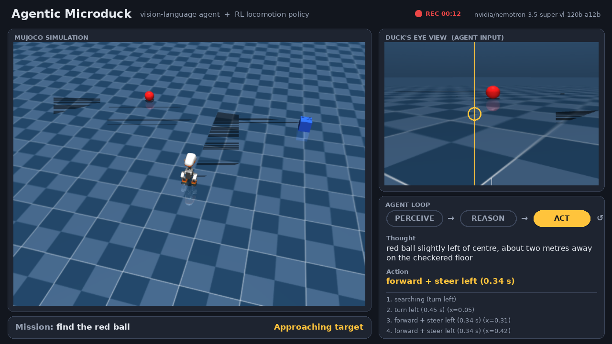
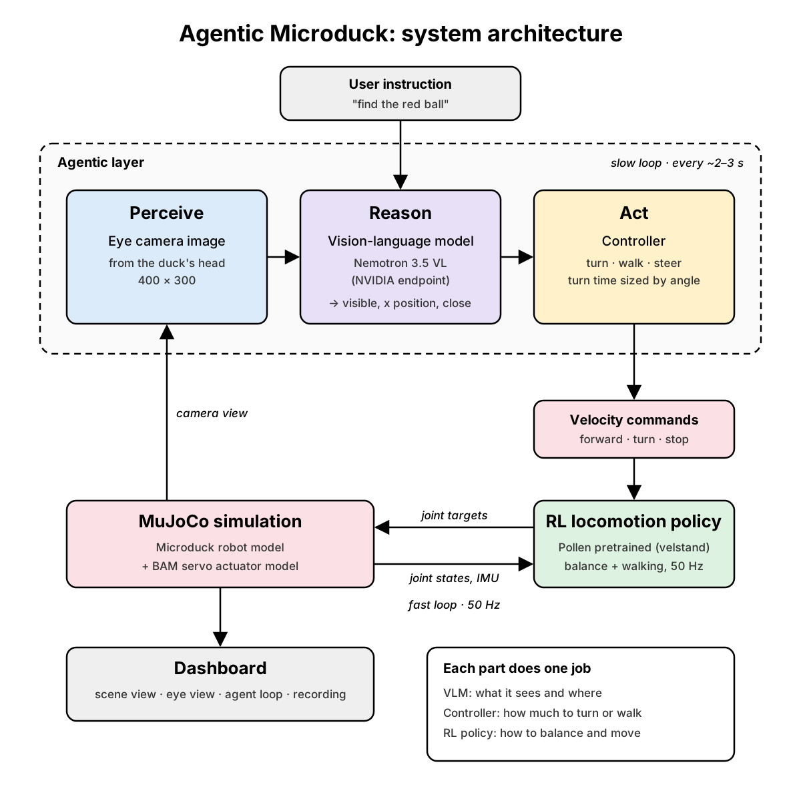

# Agentic Microduck

A vision-language agent that drives the Microduck robot in MuJoCo simulation.
You type a goal like "find the red ball", and the robot looks around with its
head camera, decides where to go, and walks there.



Microduck is a small open-source biped robot made by
[Pollen Robotics](https://www.pollen-robotics.com/) (part of Hugging Face).
The walking and balance come from Pollen's pretrained reinforcement learning
policy in [microduck_rl](https://github.com/pollen-robotics/microduck_rl).
This repo adds the agent on top of it.

## How it works



The agent runs a simple loop:

1. **Perceive** - take an image from a camera in front of the robot's head
2. **Reason** - a vision-language model says whether the target is in view,
   where it is across the image (0 = left edge, 1 = right edge), and whether
   it is close
3. **Act** - a small controller turns that position into a turn angle and
   sends forward / turn / stop commands
4. The RL policy does the actual walking and balancing at 50 Hz

Then it looks again. One step of this loop takes a few seconds.

### Why the vision model does not pick the moves

In the first version the vision model chose the action directly ("turn left",
"turn right", "forward"). It could see the ball fine, but every turn
overshot, so the robot kept swinging left and right without moving forward.

Now each part has one job:

- the vision model only reports what it sees and where
- the controller works out how much to turn (the camera sees about 58 degrees
  across, so the position maps to an angle)
- the RL policy handles balance and walking

## What's in here

| File | What it does |
|---|---|
| `agent/duck_eyes_agent.py` | The vision agent: perceive, reason, act loop |
| `agent/duck_eyes_sim.py` | Runs Pollen's `infer_policy.py` and saves the eye camera and an outside view to image files |
| `agent/duck_dashboard.py` | One window with the scene, the eye view and the agent loop. Press R to record |
| `scenes/scene_eyes.xml` | Pollen's backlash scene plus a red ball, a blue box and a green ball |

## Setup

Tested on Ubuntu 22.04.

**1. Get microduck_rl and its environment**

```bash
git clone https://github.com/pollen-robotics/microduck_rl
cd microduck_rl
curl -LsSf https://astral.sh/uv/install.sh | sh   # if you don't have uv
uv sync
```

**2. Download Pollen's trained policies**

```bash
uvx hf download pollen-robotics/microduck-policies --local-dir pretrained
```

You need `pretrained/velstand.onnx` (walking with fall recovery).

**3. Copy this project into it**

```bash
git clone https://github.com/Aachal-Sharma/agentic-microduck
./agentic-microduck/install.sh ~/microduck_rl
```

This copies the agent scripts into `microduck_rl/` and the scene into the
robot model folder. Nothing in Pollen's code is changed.

**4. Get an NVIDIA API key**

Make a free account on [build.nvidia.com](https://build.nvidia.com), then
Profile -> API Keys -> Generate.

```bash
export NVIDIA_API_KEY=nvapi-...
```

## Run

From inside `microduck_rl`:

```bash
uv run --with openai --with pillow --with opencv-python python duck_eyes_agent.py
```

The MuJoCo window and the dashboard open by themselves. When the terminal
asks what to find, type something like:

```
the red ball
```

Try `the blue box` and `the green ball` too.

**Recording:** click the dashboard window and press `R` to start and stop.
Videos are saved to `recordings/` as H.264 MP4 (needs ffmpeg:
`sudo apt install ffmpeg`).

**Other vision models:** any vision model on NVIDIA's endpoint should work.

```bash
export DUCK_MODEL=meta/llama-3.2-11b-vision-instruct
```


## Tuning

If the robot overshoots or barely turns, change these at the top of
`duck_eyes_agent.py`:

- `TURN_LAG` - how long the policy takes to start turning (default 0.25 s)
- `TURN_RATE` - how fast it turns once it starts (default 130 deg/s)
- `CENTER_BAND`, `STEER_BAND` - how far off-centre the target can be before
  it steers or turns in place

## Limitations

- Simulation only, not tested on the real robot
- Uses Pollen's pretrained walking policy; nothing here is trained
- The vision model sometimes gets the position wrong, and the agent can still
  lose the target or give up
- No memory yet: if it loses sight of the target it searches from scratch
- No success-rate numbers yet

## Next

- Remember where objects were last seen
- Walk around obstacles on the way to the target
- Measure success rate over many runs

## Credits

- Microduck robot, models and RL code: [Pollen Robotics](https://github.com/pollen-robotics) / Hugging Face
- Simulation: [MuJoCo](https://mujoco.org/) by Google DeepMind
- Vision model: NVIDIA developer endpoints

## License

Apache 2.0, same as microduck_rl. `scenes/scene_eyes.xml` is based on
Pollen Robotics' `scene_backlash.xml` (Apache 2.0). See [NOTICE](NOTICE).
The robot's 3D mesh files are not included here; they come with microduck_rl
under their own license (CC BY-NC-SA 4.0).

Made by Aachal Sharma (IIT Mandi).
